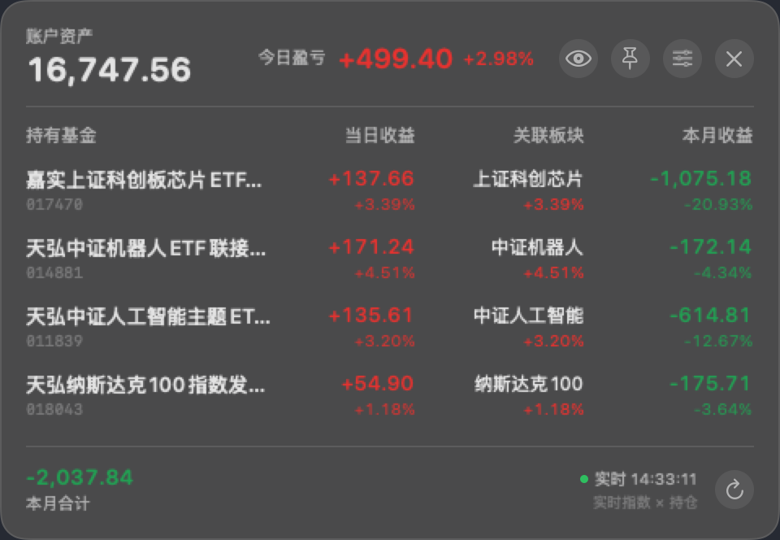
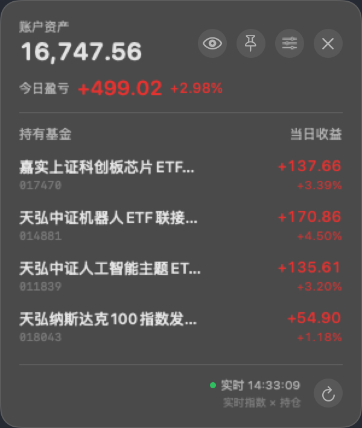
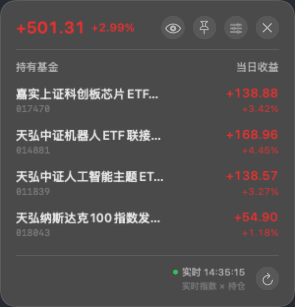

# 基金盈亏 · macOS 菜单栏悬浮面板

> 英文代号 FundBar，仓库名 `jijin-yingkui`。

在 macOS 菜单栏常驻显示「今日盈亏」，点开是一个半透明浮窗，逐只列出持有基金、当日收益、关联板块和本月收益。

> 个人自用项目，非官方。与「养基宝」及其开发方无任何关联。



## 功能

- **菜单栏常驻**：显示今日盈亏合计，红涨绿跌，颜色随正负变化
- **悬浮面板**：逐只基金 / 当日收益（金额 + 百分比）/ 关联板块 / 本月收益
- **显示设置**：任意开关「账户资产 / 关联板块 / 本月收益」三列，面板宽度自动跟随
- **一键遮金额**：眼睛图标把金额换成圆点，百分比保留，适合在公共场合看
- **置顶常驻**：图钉打开后半透明浮窗钉在所有桌面空间，可拖动
- **背景透明度**：25%–100% 可调
- **位置记忆**：拖到哪儿下次就在哪儿
- **自动刷新**：每 20 秒一次；面板打开时立即刷新

| 精简列 | 隐藏金额 |
|---|---|
|  |  |

## 系统要求

- **Apple Silicon 的 Mac**（M1/M2/M3/M4）
- **macOS 13 或更高**
- **已安装「养基宝」iOS 版并登录、至少打开过一次**（本程序读取它在本机生成的数据库）

> 为什么必须 Apple Silicon：数据源 App 是 iOS 应用，只能运行在 Apple Silicon 的 Mac 上。

## 安装

### 方式一：下载安装包

1. 解压 `基金盈亏-mac.zip`
2. 双击 `安装.command`（首次会被 Gatekeeper 拦截：右键 → 打开）
3. 脚本会装到 `~/Applications`、解除隔离标记并启动

### 方式二：自己编译

```bash
git clone https://github.com/stargif/jijin-yingkui.git
cd jijin-yingkui
./build.sh          # 产出 基金盈亏.app
open 基金盈亏.app
```

只需要 Xcode 命令行工具（`xcode-select --install`），无第三方依赖。

## 工作原理

程序不登录、不抓包、不调用私有接口，只做两件事：

1. **读取本机数据库**：定位 `~/Library/Containers/*/Data/Documents/YJB.sqlite`（数据源 App 的本地缓存），读出持仓金额、本月收益、关联板块。
2. **拉取公开行情**：用板块名到东方财富解析对应指数代码（解析一次后缓存），再批量取当日涨跌幅。

**当日收益 = 持仓金额 × 板块涨幅**

| 数据 | 来源 | 更新频率 |
|---|---|---|
| 持仓、金额 | 本地数据库 | 跟随数据源 App 同步 |
| 本月收益 | 本地数据库 | 跟随数据源 App 同步（净值收盘后公布） |
| 当日涨幅 | 东方财富指数行情 | 20 秒 |

## 隐私

- 不上传任何数据，项目没有服务端
- 不接触账号、密码、Cookie
- 外部网络请求只有公开指数行情，只传板块名，不传持仓

## 已知限制

1. **更新时机受数据源 App 控制**。它只在自己同步时写本地库（打开、切页、下拉刷新），所以你刚改完持仓，要等它同步一次本程序才能看到。
2. **本月收益无法实时**。必须等每日净值公布。
3. **新基金的板块**会自动联网解析指数代码；实在解析不到的，回退成数据源 App 里的旧值。
4. **未做签名公证**，首次启动需要右键打开（安装脚本已自动处理隔离标记）。

## 开发

```
Sources/main.swift   全部实现（AppKit + SwiftUI，单文件，无第三方依赖）
Info.plist           应用元信息
build.sh             编译打包脚本
docs/                截图
```

调试时打开日志：

```bash
touch /tmp/fundbar-debug     # 或 FUNDBAR_DEBUG=1
tail -f /tmp/fundbar.log
```

## 常见问题

### git 连不上 github.com（push/pull 卡住）

**现象**：`git push` / `git pull` 一直挂着不动，但浏览器能正常打开 GitHub，`gh api` 也能用。

**原因**：`git` 不读取 macOS 的系统代理设置，它会直连 GitHub。某些网络环境下 `github.com` 的 IP 被单独拦截，而 `api.github.com` 正常，于是出现「`gh` 能用、`git` 不能用」的怪现象。

**解决**：让 git 单独走代理（端口以你实际代理软件为准）：

```bash
# 只对 github.com 生效，不影响其它站点
git config --global http.https://github.com/.proxy http://127.0.0.1:7897
```

验证：

```bash
git ls-remote https://github.com/<user>/<repo>.git
```

能列出分支即成功。要取消：

```bash
git config --global --unset http.https://github.com/.proxy
```

### 面板数字不跳动

看面板右下角有没有绿点和「实时」：

- **有绿点** → 行情是通的，数字不跳是因为收盘了（A 股 15:00 后指数不再变化）
- **没有绿点，显示「数据 时间」** → 指数行情没取到；若长期如此，检查网络能否访问 `push2.eastmoney.com`

## 免责声明

本项目为非官方个人工具，与「养基宝」及其开发方无任何关联，也未获得其授权或认可。程序仅读取本机已登录客户端自己产生的本地数据文件，不进行网络抓包、不绕过任何鉴权、不修改数据源 App 的任何内容。数据仅供参考，不构成投资建议，盈亏以官方客户端为准。

## License

[MIT](LICENSE)
